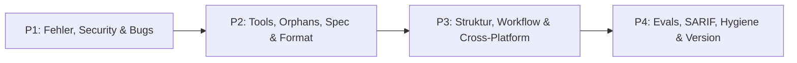

# Verbesserungsanalyse: <Skill-/Repo-Name> (v<Version>)

**Fazit:** <Gesamturteil in 1–2 Sätzen>. Gefunden: **<n> bestätigte P1-Fehler/Bugs**, **<m> Link-/Format-/Tool-Befunde (P2)** und <größtes Struktur-/Effizienzpotenzial>.

## Bestandsaufnahme (Größe ≈ Tokens)

| Datei | Zeichen | ≈ Tokens | Zeilen | TOC |
|---|---:|---:|---:|:---:|
| `SKILL.md` | <…> | <…> | <…> | ✅/❌ |
| `references/<…>.md` | <…> | <…> | <…> | ✅/❌ |

> [!NOTE]
> <Kurzbewertung des Kontext-Budgets: z. B. „Gesamtgröße optimal, kein Split nötig“ ODER Warnung bei > 60k Tokens / Doppelpflege.>

---

## 🔴 Priorität 1: Fachliche Fehler, Sicherheit & Bugs (verifiziert)

| # | Fundstelle | Problem (Fachlich / Unicode-Smuggling / AST / Secrets) | Korrektur |
|---|---|---|---|
| F1 | [`<datei>#L<z>`](file:///…) | <Problem inkl. Regel-ID, z. B. `SV-P1-01`> | <konkrete Korrektur> |

## 🟠 Priorität 2: Ausführbarkeit, Spec, Links & Formatierung
- **Defekte Links / Codeblöcke / Mermaid / Format-Lint:** <Befund mit Fundstelle>
- **Tote Verweise, Orphan-Files & `agentskills.io`-Spec (`file_names`, `name`/`compatibility`, `__pycache__`):** `<liste>`
  - **Option A (empfohlen):** <echtes Hilfsskript mit `--self-test` mitliefern bzw. Orphan-Files verlinken/bereinigen>
  - **Option B:** <auf „falls verfügbar“ umformulieren + Fallback ergänzen>

## 🟡 Priorität 3: Struktur, Effizienz & Plattform-Tauglichkeit
1. <Nur vorschlagen, was zur Größe passt — kein Over-Engineering bei kleinen Skills!>
2. <Keine README-Tier-Sektionen (`Installation`/`License`/`Contributing`) oder Cross-Language-Contamination; Multi-Step-Workflow-Qualität (Exit-Kriterien, Retry-Limit + Fallback, beobachtbare Trigger)>
3. <Zweisprachige Description (DE+EN), portabler Pfad, Bundle-Budget (> 46 KB), Modus A/B, Sicherheitsklausel>

## 🔵 Priorität 4: Qualitätssicherung & Hygiene

| Maßnahme | Nutzen |
|---|---|
| `evals/cases.json` (inkl. Negative-Trigger & Leakage-Lint) | <…> |
| Selbsttests / Validator (`--fail-on p2`, `--sarif`) + CI *(bei Git-Repos)* | <…> |
| `LICENSE` + `NOTICE.md` + `CHANGELOG.md` *(bei Git-Repos mit externen Quellen)* | <…> |

---

## Empfohlene Umsetzungsreihenfolge

Aufwand: <kurze realistische Einschätzung>.
