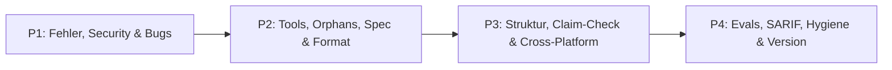

# Verbesserungsanalyse: <Skill-/Repo-Name> (v<Version>)

**Fazit:** <Gesamturteil in 1–2 Sätzen>. Gefunden: **<n> bestätigte P1-Fehler/Bugs (`[Verifiziert]`)**, **<m> Link-/Format-/Tool-/Security-Befunde (P2)** (davon <k> `[Heuristik / Verdacht]` zur manuellen Bestätigung) und <größtes Struktur-/Effizienzpotenzial>. *(Hinweis: Es wurde noch nichts geändert; Umsetzung erfolgt erst nach Freigabe.)*

> [!IMPORTANT]
> **Diagnose-Sicherheit:** Jeder Befund ist als **`[Verifiziert]`** (deterministisch per Skript, AST, Link-Check, `grep -n` oder Reproduktion bestätigt) oder **`[Heuristik / Verdacht]`** (Muster-/Kontext-Indiz, vor Eingriff manuell zu bestätigen) gekennzeichnet.

## Zweck, Scope & Ziel-Domäne (verifiziert vor Architektur-Bewertung)
- **Skill / Modus:** `<name>` (`skill-folder` / `git-repo`) | **Domäne:** `<Fach-/Wissens- | Coding-/DevOps- | Workflow-/Prompt-Skill>`
- **Erklärter Zweck (`description`):** <Kurzfassung direkt aus `SKILL.md`>
- **Explizite Abgrenzung (`Don't use`):** <vorhanden: … / fehlt>
- **Anspruch-vs.-Wirklichkeit (Claim-vs.-Reality) & Widerspruchs-Check (`SV-P3-09`):** <Stimmen `description`, Body, versprochene CLI-Flags & `scripts/` überein? Gibt es Widersprüche zwischen `Don't use` und Body?>
- **Rückfrage-Gate (Clarification Gate):** <Keine Rückfrage nötig (Zweck eindeutig) ODER offene Klärungsfrage an den Nutzer vor Architektur-Umbau>

## Bestandsaufnahme (Größe ≈ Tokens)

| Datei | Zeichen | ≈ Tokens | Zeilen | TOC |
|---|---:|---:|---:|:---:|
| `SKILL.md` | <…> | <…> | <…> | ✅/❌ |
| `references/<…>.md` | <…> | <…> | <…> | ✅/❌ |

- **Security-Scan-Coverage:** `<scanned_files>` Dateien geprüft (`.py`, `.sh`/`.bash`, `.js`/`.ts`, `.ps1`, `.env`, `.toml`, `.yaml`, `.json`, `.md`), `<skipped_files>` übersprungen.

> [!NOTE]
> <Kurzbewertung des Kontext-Budgets: z. B. „Gesamtgröße optimal (< 15k Tokens), kein Split nötig“ ODER Warnung bei > 40k/60k Tokens / Doppelpflege.>

---

## 🔴 Priorität 1: Fachliche Fehler, Sicherheit & Bugs (verifiziert)

| # | Fundstelle (`Datei:Zeile`) | Konkreter Nachweis (Evidenz/Snippet) | Problem & Auswirkung (inkl. Regel-ID) | Diagnose-Sicherheit (`Verifiziert` \| `Heuristik`) | Korrekturvorschlag | Regressionstest |
|---|---|---|---|---|---|---|
| F1 | [`<datei>#L<z>`](file:///…) | `` `<exaktes Code-/Text-Snippet>` `` | <Problem & Auswirkung, z. B. `SV-P1-05` / fachlicher Fehler> | `[Verifiziert]` | <konkrete, verlustfreie Korrektur> | <Befehl/Check, z. B. `skill_audit.py --fail-on p1` oder `--self-test`> |

## 🟠 Priorität 2: Ausführbarkeit, Spec, Links & Formatierung

| # | Fundstelle (`Datei:Zeile`) | Konkreter Nachweis (Evidenz/Snippet) | Problem & Auswirkung (inkl. Regel-ID) | Diagnose-Sicherheit (`Verifiziert` \| `Heuristik`) | Korrekturvorschlag | Regressionstest |
|---|---|---|---|---|---|---|
| P2-1 | [`<datei>#L<z>`](file:///…) | `` `<Link / Referenz / audit-ok ohne Grund>` `` | <z. B. `SV-P2-01` defekter Link / `SV-P2-02` toter Verweis / `SV-P2-03` Orphan / fehlendes `# audit-ok: <Begründung>`> | `[Verifiziert]` / `[Heuristik / Verdacht]` | <konkreter Fix, z. B. Option A oder Option B unten> | <z. B. `skill_audit.py <ziel> --fail-on p2`> |

- **Defekte Links / Codeblöcke / Mermaid / Format-Lint (`SV-P1-01`, `SV-P2-01`, `SV-P2-04`, `SV-P2-05`):** <Befund mit `Datei:Zeile` und Snippet>
- **Tote Verweise, Orphan-Files, unbegründete `audit-ok`-Marker (Pflicht: `# audit-ok: <Begründung>`) & `agentskills.io`-Spec (`file_names`, `name`/`compatibility`, `__pycache__`):** `<liste>`
  - **Option A (empfohlen):** <echtes Hilfsskript mit `--self-test` mitliefern, Orphan-Files verlinken/bereinigen bzw. `# audit-ok: <Begründung>` ergänzen>
  - **Option B:** <auf „falls verfügbar“ umformulieren + Fallback ergänzen>

## 🟡 Priorität 3: Struktur, Effizienz & Plattform-Tauglichkeit
1. <Nur vorschlagen, was zur Größe passt — kein Over-Engineering bei kleinen Skills!>
2. <Claim-vs.-Reality & Widerspruchs-Abgleich (`SV-P3-09`) sowie Versions- & Regel-Konsistenz (`SV-P3-10`) zwischen Code-SSOT, Doku & Evals>
3. <Keine README-Tier-Sektionen (`Installation`/`License`/`Contributing`) oder Cross-Language-Contamination (`SV-P3-06`, `SV-P3-07`); Multi-Step-Workflow-Qualität (Exit-Kriterien, Retry-Limit + Fallback, beobachtbare Trigger)>
4. <Zweisprachige Description (DE+EN, ≤ 1024 Zeichen), portabler Pfad, Bundle-Budget (> 46 KB), Modus A/B, Sicherheitsklausel>

## 🔵 Priorität 4: Qualitätssicherung & Hygiene

| Maßnahme | Nutzen |
|---|---|
| `evals/cases.json` (inkl. Negative-Trigger, Adversarial-Fällen, `verification_rubric` & Leakage-Lint) | <…> |
| Selbsttests / Validator (`--fail-on p2`, `--sarif`, 28 Regeln `SV-P1-01`…`SV-P3-10` inkl. `SV-P2-12`) + CI *(bei Git-Repos)* | <…> |
| `LICENSE` + `NOTICE.md` + `CHANGELOG.md` *(bei Git-Repos mit externen Quellen)* | <…> |

---

## Empfohlene Umsetzungsreihenfolge

Aufwand: <kurze realistische Einschätzung>. Umsetzung erfolgt nach Freigabe im kontrollierten Staged-Approval-Workflow (`git status --short` → `git diff --stat` → gezieltes `git add <datei>` → getrennte Freigabe für Commit & Push).
